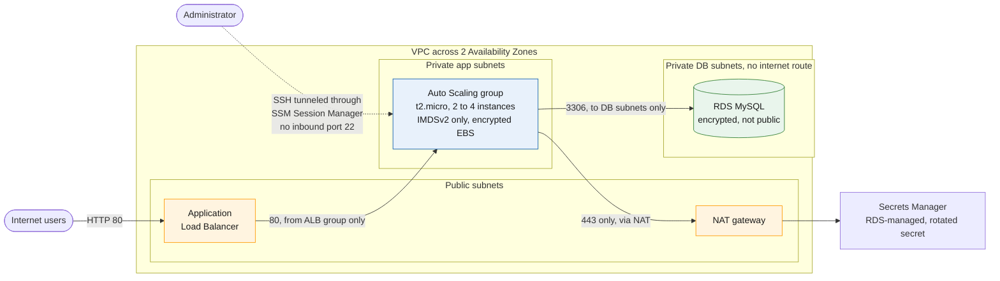
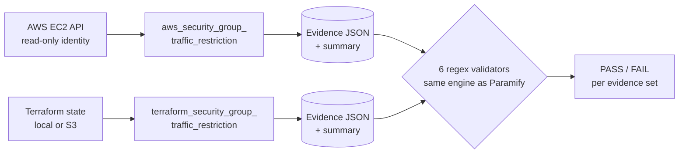

<div align="center">

# Compliance as Code on AWS

### A three-tier web app rebuilt in Terraform, with security controls proven by automated evidence


</div>

---

## In one minute

A small research nonprofit ran its PHP website and MySQL database on a single public server and
had just survived a ransomware attempt. I re-architected it on AWS as a private, highly available,
three-tier system, built entirely with Terraform, then went one step further than the brief:
**I wrote evidence fetchers and validators that prove the network controls work, found a gap with
them, fixed it in code, and proved the fix with the same automation.**

| | |
|:--|:--|
| **Infrastructure** | ALB across 2 AZs, Auto Scaling app tier in private subnets, private encrypted RDS, all in Terraform |
| **Security findings** | 11 documented against NIST 800-53, each with a severity, an owner decision and a fix |
| **Automated proof** | 2 fetchers, 6 validators, 1 FedRAMP 20x indicator, evidence collected from two independent sources |
| **Verified fix** | Unrestricted egress went from **FAIL on 5 of 5 security groups** to **PASS** after one reviewed Terraform change |
| **Cost control** | One switch takes every billable resource to zero when idle; a fixed lab budget was never at risk |

---

## Contents

- [Architecture](#architecture)
- [The compliance story: find, fix, prove](#the-compliance-story-find-fix-prove)
- [How the evidence pipeline works](#how-the-evidence-pipeline-works)
- [Security assessment](#security-assessment)
- [Requirements traceability](#requirements-traceability)
- [Engineering decisions](#engineering-decisions)
- [Production recommendations](#production-recommendations)
- [Run it yourself](#run-it-yourself)
- [Roadmap](#roadmap)

---

## Architecture



Traffic moves one tier at a time and only on the port that tier needs. Every hop is enforced by a
security group, and every security group is defined in Terraform.

---

## The compliance story: find, fix, prove

The control under test is **FedRAMP 20x KSI-CNA-RNT, Restricting Network Traffic**: traffic in and
out of the system is limited to what it actually needs.

### 1. Find

Two fetchers looked at the same control from two angles. The validators failed on outbound
traffic: every security group, including the database's, allowed all traffic to anywhere.

The two sources also disagreed. AWS reported **5** security groups, while Terraform knew about
only **3**. The two missing ones were default security groups that no code controlled, and a
Terraform-only audit would never have seen them.

### 2. Fix

One reviewed Terraform plan (`2 to add, 3 to change, 0 to destroy`):

| Tier | Outbound before | Outbound after |
|:--|:--|:--|
| Load balancer | All traffic, anywhere | Port 80 to the app subnets only |
| App servers | All traffic, anywhere | Port 443 out (packages, AWS APIs), port 3306 to the DB subnets |
| Database | All traffic, anywhere | **None.** A database never needs to start a connection |
| Default groups (2) | All traffic | **No rules at all**, and now under Terraform control |

### 3. Prove

The same fetchers and validators, run again:

| Run | AWS API (what is enforced) | Terraform (what was declared) | Egress validator |
|:--|:--|:--|:--:|
| **Before** | 5 groups, 5 with unrestricted egress | 3 groups, 3 with unrestricted egress | ❌ FAIL |
| **After** | 5 groups, 0 with unrestricted egress | 5 groups, 0 with unrestricted egress | ✅ PASS |

All six validators now pass on both sources, and both sources agree on every security group.

---

## How the evidence pipeline works



Both fetchers are built on the open-source
[paramify-fetchers](https://github.com/paramify/paramify-fetchers) framework and write
**identical summary fields**, so a single set of validators reads either source. That design is
the point: one claim, two independent proofs, and any disagreement between them is a finding.

| Validator | Passes when |
|:--|:--|
| `collection_succeeded` | The fetcher finished without errors |
| `sg_groups_evaluated` | At least one group was evaluated, so empty evidence cannot pass |
| `sg_world_ingress_authorized_ports_only` | Nothing is open to the internet except ports 80 and 443 |
| `sg_no_world_open_admin_ports` | SSH (22) and RDP (3389) are closed to the internet |
| `sg_no_world_open_database_ports` | No database port is open to the internet |
| `sg_no_unrestricted_egress` | No group allows all traffic outbound to the internet |

<details>
<summary><b>How the validators are tested</b></summary>

<br/>

A validator that can only ever pass is worse than none, because it looks like assurance. Every
validator here has three test cases: compliant evidence that must pass, violating evidence that
must fail, and evidence with a renamed field that must also fail instead of passing silently. A
fourth case runs the whole validator set together and confirms a failed collection run cannot
produce a pass.

The fetchers have 9 unit tests on synthetic data, including one that confirms the AWS and
Terraform fetchers produce the same summary for the same stack.

</details>

<details>
<summary><b>Handling secrets in Terraform state</b></summary>

<br/>

Terraform state can contain passwords and keys, so the Terraform fetcher copies out only security
group attributes. A test plants a fake secret in a state file and asserts it never appears in the
evidence. Each evidence file records the state's SHA-256 hash, serial and lineage, so an assessor
can tie it to one specific `terraform apply`.

</details>

<details>
<summary><b>Sample evidence summary (identifiers removed)</b></summary>

```json
{
  "source": "terraform_state",
  "results": {
    "summary": {
      "groups_total": 5,
      "ingress_rules_total": 4,
      "sg_referenced_ingress_rules": 2,
      "world_open_ingress_rules": 2,
      "world_open_admin_port_rules": 0,
      "world_open_db_port_rules": 0,
      "world_open_disallowed_rules": 0,
      "unrestricted_egress_groups": 0
    }
  }
}
```

</details>

---

## Security assessment

I reviewed the starting environment, the provided application code and the lab configuration the
way an assessor would. Each finding has a status that reflects a deliberate decision.

| # | Finding | NIST 800-53 | Severity | Status |
|:--:|:--|:--|:--|:--|
| 1 | The application writes the database password to the web server error log on every request | IA-5, AU-9 | High | Open: app code used as provided. RDS secret rotation limits exposure |
| 2 | The web server role can read the whole account and write to every secret | AC-6 | High | Open: lab cannot change IAM. Scoped policy written as a recommendation |
| 3 | No CloudTrail trail, VPC Flow Logs or AWS Config recorder | AU-2, AU-12, CA-7 | High | Open: services restricted in the lab |
| 4 | HTTP only, no TLS on the load balancer | SC-8 | High | Accepted: out of scope per the brief |
| 5 | The application picks the first secret and first database in the account | CM-6 | Medium | Open: recommend passing the secret ARN explicitly |
| 6 | A MySQL server package is installed on every web server | CM-7 | Medium | Open: recommend client-only image |
| 7 | Code is downloaded at boot with no integrity check; packages unpinned | SI-7, CM-2 | Medium | Open: recommend a golden AMI |
| 8 | **Unrestricted outbound traffic on every tier, including the database** | **SC-7** | **Medium** | ✅ **Remediated and verified** |
| 9 | Single NAT gateway in one AZ; single-AZ database | CP-10 | Medium | Open: cost trade-off for the lab |
| 10 | Port 443 allowed on the load balancer and app groups with no HTTPS listener | CM-7 | Low | Planned: Phase 2b |
| 11 | **Default security groups allowed traffic and sat outside any code** | **CM-7** | **Low** | ✅ **Remediated** (CIS AWS 5.4); deleting the unused default VPC still recommended |

---

## Requirements traceability

| Customer requirement | How it is met | Control |
|:--|:--|:--|
| Secure hosting of the MySQL database | RDS in private subnets with no internet route, not publicly accessible, storage encrypted | SC-28, SC-7 |
| Secure access to the database | Port 3306 allowed only from the app tier; credentials held in Secrets Manager | AC-3, IA-5 |
| Anonymous access for web users | Internet-facing load balancer on port 80 | Scope assumption |
| Web servers in private subnets with admin SSH | App tier in private subnets; SSH tunneled through SSM, so no port 22 is open anywhere | AC-17 |
| High availability through a load balancer | Load balancer across two Availability Zones with health checks | CP-10 |
| Automatic scaling with a launch template | Hardened launch template; Auto Scaling group of 2 to 4 with CPU target tracking at 50% | SC-5 |

---

## Engineering decisions

<details>
<summary><b>Adopt what exists instead of rebuilding it</b></summary>

<br/>

The environment arrived with security groups, a NAT gateway and a network already in place, the
same situation as most real clients. Rather than recreate them, I brought them under Terraform
with `import` blocks, kept their IDs and existing tags, and protected them with
`prevent_destroy`. The network itself is read through `data` sources and never managed, so no
Terraform command can delete it.

</details>

<details>
<summary><b>No database password in code or in Terraform state</b></summary>

<br/>

`manage_master_user_password = true` has RDS generate the password and store it in Secrets
Manager with rotation. The password never exists in this repository or in Terraform state, which
removes the most common way IaC projects leak credentials.

</details>

<details>
<summary><b>SSH access with no open ports</b></summary>

<br/>

The brief required SSH for administrators. Administrators get real SSH, tunneled through SSM
Session Manager. No security group allows port 22, there is no bastion host to patch, and every
session is authenticated through IAM and recorded by SSM.

</details>

<details>
<summary><b>Hardened launch template</b></summary>

<br/>

The template reuses the provided AMI and bootstrap script through a data source, so no
third-party content is copied into this repository, then adds IMDSv2 enforcement (which blocks
the classic SSRF-to-credential-theft path), an encrypted gp3 root volume and consistent tagging.

</details>

<details>
<summary><b>One switch for cost</b></summary>

<br/>

The lab runs on a fixed budget. Every billable resource sits behind
`count = var.stack_enabled ? 1 : 0`, and `scripts/stack.sh down` removes the NAT gateway, load
balancer, Auto Scaling group and database while leaving the free resources in place. Idle cost is
effectively zero, and `stack.sh up` rebuilds everything in about ten minutes.

`moved` blocks let me add the switch to resources that already existed without destroying them.
The script also works around a lab permission gap: the lab cannot delete scaling policies
directly, but deleting the Auto Scaling group removes them, so the script hands that cleanup to
AWS.

</details>

---

## Production recommendations

The lab could not create IAM roles and limited which services were available. With full access,
I would add:

| Area | Recommendation |
|:--|:--|
| Identity | IAM Identity Center with MFA; one least-privilege role per workload |
| Governance | AWS Organizations with service control policies; Control Tower landing zone |
| Detection | Security Hub (NIST 800-53 standard), GuardDuty, CloudTrail with metric alarms |
| Network | TLS through ACM, WAF on the load balancer, VPC endpoints instead of NAT for AWS APIs, one NAT per AZ |
| Data | Customer-managed KMS keys, Multi-AZ RDS, deletion protection, 7+ days of backups |
| Delivery | Encrypted remote state in S3 with locking; `terraform apply` only from CI after review |

---

## Run it yourself

<details>
<summary><b>Repository layout</b></summary>

```
.
├── README.md
├── .gitignore                      # state, tfvars, lab material, local evidence
├── scripts/
│   └── stack.sh                    # up | down | status: the cost switch
└── terraform/
    ├── versions.tf                 # provider and version pins, default tags
    ├── variables.tf                # inputs, including the cost switch
    ├── data.tf                     # lookups: VPCs, subnets, route table, launch template
    ├── network.tf                  # adopted NAT gateway and app route, switchable
    ├── security_groups.tf          # ALB, app and DB groups with least-privilege egress
    ├── default_security_groups.tf  # default groups in both VPCs, all rules removed
    ├── database.tf                 # RDS MySQL with an RDS-managed secret
    ├── load_balancer.tf            # ALB, target group, listener
    ├── compute.tf                  # hardened launch template, Auto Scaling group, scaling policy
    ├── moves.tf                    # state moves from adding the cost switch
    ├── outputs.tf
    ├── .terraform.lock.hcl         # pinned provider checksums
    └── lab.auto.tfvars.example     # copy to lab.auto.tfvars (gitignored)
```

</details>

<details>
<summary><b>Deploy and operate</b></summary>

**Prerequisites:** Terraform 1.6+, AWS CLI v2, the Session Manager plugin, and an AWS profile for
the target account.

```bash
cp terraform/lab.auto.tfvars.example terraform/lab.auto.tfvars   # fill in your IDs
export AWS_PROFILE=<profile>
cd terraform
terraform init
terraform plan -out=plan.tfplan     # review: nothing should be replaced or destroyed
terraform apply plan.tfplan
terraform output app_url
```

```bash
scripts/stack.sh status   # what is running and billing
scripts/stack.sh down     # remove every billable resource
scripts/stack.sh up       # bring it back in about 10 minutes (the database returns empty)
```

</details>

**Repository hygiene:** Terraform state, variable files, credentials, account IDs, lab material
and collected evidence are never committed. Every commit is scanned with
[gitleaks](https://github.com/gitleaks/gitleaks) before it is pushed.

---

## Roadmap

- [x] Phase 1: Terraform build of the full three-tier stack
- [x] Cost switch and adoption of the lab's NAT gateway
- [x] Phase 2: least-privilege egress on every tier; default security groups locked down
- [x] KSI-CNA-RNT evidence from two sources, with tested validators
- [ ] Phase 2b: remove the unused 443 rules; drift detection demo against a manual console change
- [ ] Collect evidence on a 3-day schedule and upload it to a GRC platform
- [ ] Checkov scan of this Terraform as a gate before every apply

---

<div align="center">

Built by **Bruce Weygandt** as a solo capstone for a cloud security course.<br/>
The scenario, application code and dataset belong to AWS Academy and are not included here.

</div>
