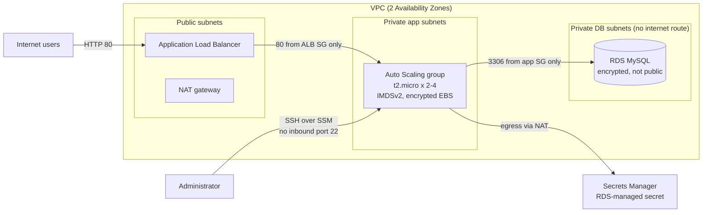

# AWS 3-Tier Web App: Terraform Build with Continuous Compliance Evidence

Re-architecture of a PHP + MySQL web application from a single public EC2 host into a
highly available, private, three-tier design on AWS, built entirely with Terraform and
assessed against FedRAMP 20x Key Security Indicators (KSIs) and NIST 800-53 controls.

> Built as a solo capstone for a cloud security course (AWS Academy Cloud Architecting
> scenario). The lab instructions, application code, and dataset belong to AWS and are
> **not** included in this repository.

## Status

| Phase | Scope | Status |
|---|---|---|
| 1 | Terraform build: ALB, Auto Scaling group, RDS MySQL, Secrets Manager, data import | Done |
| 2 | Security group hardening and drift detection | Planned |
| 3 | Scheduled evidence collection with [paramify-fetchers](https://github.com/paramify/paramify-fetchers), uploaded to Paramify with regex validators | In progress |
| 4 | Shift-left IaC scanning (Checkov) as a pre-deploy gate | Planned |

## Architecture



**Traffic is chained by security group reference, not CIDR:** internet to ALB, ALB to
app tier, app tier to database. The database subnets have no route to the internet.

## Requirements traceability

| Requirement | Implementation | KSI / Control |
|---|---|---|
| Secure hosting of the MySQL database | RDS in private DB subnets, `publicly_accessible = false`, storage encrypted | KSI-SVC, SC-28 |
| Secure access to the database | DB security group allows 3306 only from the app security group; credentials in Secrets Manager | KSI-CNA, AC-3, IA-5 |
| Anonymous access for web users | Internet-facing ALB on port 80 | Scope assumption |
| Web servers in private subnets with admin access | ASG in private subnets; admin access via SSH tunneled through SSM Session Manager | KSI-CNA, AC-17 |
| High availability through a load balancer | ALB across two AZs with health checks | KSI-CNA, CP-10 |
| Automatic scaling with a launch template | Launch template + ASG (min 2, max 4) with CPU target tracking at 50% | KSI-CNA, SC-5 |

## Key design decisions

- **Brownfield adoption instead of rebuild.** The environment came with pre-provisioned
  security groups. They are brought under Terraform with `import {}` blocks and
  `lifecycle { prevent_destroy = true }`, keeping their IDs and existing tags, so
  Terraform owns their rules and drift detection covers them. Pre-provisioned network
  resources (VPC, subnets, DB subnet group, IAM instance profile) are referenced with
  `data` sources and never managed.
- **No database password in code or state.** `manage_master_user_password = true` lets
  RDS create and rotate the secret in Secrets Manager. The password never appears in
  Terraform files or `terraform.tfstate`.
- **Hardened launch template.** Reuses the source template's AMI and bootstrap through a
  data source (so no third-party content is copied), then adds IMDSv2 enforcement
  (`http_tokens = "required"`), an encrypted gp3 root volume, and consistent tagging.
- **SSH without open ports.** Administrators use real SSH tunneled through SSM Session
  Manager (`AWS-StartSSHSession`). No security group allows inbound port 22, there is
  no bastion host, and every session is authenticated by IAM and recorded by SSM.
- **Credential-safe data import.** The SQL dump was loaded from an app instance through
  an SSM session, reading credentials from Secrets Manager at runtime, passing the
  password through `MYSQL_PWD` instead of the command line, and deleting the dump after.

## Security assessment findings

Findings from reviewing the starting environment, the provided application, and the lab
configuration. Items marked *accepted* are out of scope for this build by design.

| # | Finding | Control | Severity | Recommendation |
|---|---|---|---|---|
| 1 | Application writes the database password to the web server error log in plaintext on every request | IA-5, AU-9 | High | Remove the logging call; RDS-managed rotation limits exposure as a compensating control |
| 2 | Web server role has `ReadOnlyAccess` to the whole account plus write access to every secret | AC-6 | High | Scoped policy: `GetSecretValue` on one secret ARN, `rds:DescribeDBInstances`, SSM core |
| 3 | No CloudTrail trail, VPC Flow Logs, or AWS Config recorder | AU-2, AU-12, CA-7 | High | Organization trail, flow logs to S3, Config conformance pack |
| 4 | HTTP only, no TLS on the load balancer | SC-8 | High (*accepted* per scope) | ACM certificate, HTTPS listener, HTTP-to-HTTPS redirect |
| 5 | Application selects the first secret and first RDS instance in the account | CM-6 | Medium | Pass the secret ARN and endpoint explicitly (environment or SSM parameter) |
| 6 | MySQL server package installed on every web server | CM-7 | Medium | Install the client only, or bake a minimal AMI |
| 7 | Code downloaded at boot without integrity checks; unpinned package updates | SI-7, CM-2 | Medium | Golden AMI via EC2 Image Builder, or hash-verified artifacts from a private bucket |
| 8 | Unrestricted egress on all tiers, including the database | SC-7 | Medium | DB: no egress. App: 443 and 3306 to the DB SG only |
| 9 | Single NAT gateway in one AZ; single-AZ database | CP-10 | Medium | One NAT per AZ (or VPC endpoints); Multi-AZ RDS |
| 10 | Port 443 allowed on ALB and app security groups with no HTTPS listener | CM-7 | Low | Remove until TLS is implemented |
| 11 | Default VPC present with auto-assigned public IPs | CM-7 | Low | Delete default VPCs in unused regions |

## Lab constraints and full-access recommendations

The lab account could not create IAM roles and limited services to what the scenario
required. With full access, the recommended production design adds:

- **Identity:** IAM Identity Center with MFA for console access; per-workload least-privilege roles
- **Governance:** AWS Organizations with service control policies; Control Tower landing zone
- **Detection:** Security Hub (NIST 800-53 standard), GuardDuty, CloudTrail with metric alarms
- **Network:** WAF on the ALB, VPC endpoints for SSM and Secrets Manager, NAT per AZ
- **Data:** customer-managed KMS keys, Multi-AZ RDS, deletion protection, automated backups retained 7+ days
- **Delivery:** remote Terraform state in encrypted S3 with locking; CI/CD-gated `terraform apply`

## Repository layout

```
.
├── README.md
├── .gitignore                      # state, tfvars, lab material, local evidence
└── terraform/
    ├── .terraform.lock.hcl         # pinned AWS provider version
    ├── versions.tf                 # Terraform/provider versions, default tags
    ├── variables.tf                # inputs (network names, sizing, lab IDs)
    ├── data.tf                     # lookups: VPC, subnets, source launch template
    ├── security_groups.tf          # imported ALB/app/DB SGs (rules + tags mirrored)
    ├── database.tf                 # RDS MySQL with RDS-managed secret
    ├── load_balancer.tf            # ALB, target group, HTTP listener
    ├── compute.tf                  # hardened launch template, ASG, CPU scaling policy
    ├── outputs.tf                  # app URL, DB endpoint, secret ARN, ASG name
    └── lab.auto.tfvars.example     # template; copy to lab.auto.tfvars (gitignored)
```

## Deploy

**Prerequisites:** Terraform 1.6+, AWS CLI v2, Session Manager plugin, an AWS profile
with credentials for the target account.

```bash
cp terraform/lab.auto.tfvars.example terraform/lab.auto.tfvars   # fill in your IDs
export AWS_PROFILE=<profile>
cd terraform
terraform init
terraform plan -out=plan.tfplan     # expect: 3 to import, 7 to add, 0 to destroy
terraform apply plan.tfplan
terraform output app_url
```

**Pause between sessions to save cost** (the NAT gateway still bills):

```bash
terraform apply -var=asg_min=0 -var=asg_desired=0 -auto-approve
aws rds stop-db-instance --db-instance-identifier aca-capstone-mysql
```

**Resume:**

```bash
aws rds start-db-instance --db-instance-identifier aca-capstone-mysql
aws rds wait db-instance-available --db-instance-identifier aca-capstone-mysql
terraform apply -auto-approve
```

## Repository hygiene

- Never committed: Terraform state, `*.auto.tfvars`, account IDs, credentials, lab materials
- Every commit scanned with [gitleaks](https://github.com/gitleaks/gitleaks) before push
- Infrastructure uses default tags (`Project`, `Environment`, `ManagedBy`) for traceability

## Roadmap

- **Phase 2:** remove unused 443 rules, restrict egress per tier, demonstrate drift
  detection (`terraform plan -detailed-exitcode`) against a manual console change
- **Phase 3:** collector instance running paramify-fetchers on a 3-day schedule
  (systemd timer), uploading JSON evidence to Paramify where regex validators map
  results to KSIs
- **Phase 4:** Checkov scan of this Terraform as a pre-deploy gate, with its results
  uploaded as evidence alongside the runtime checks
