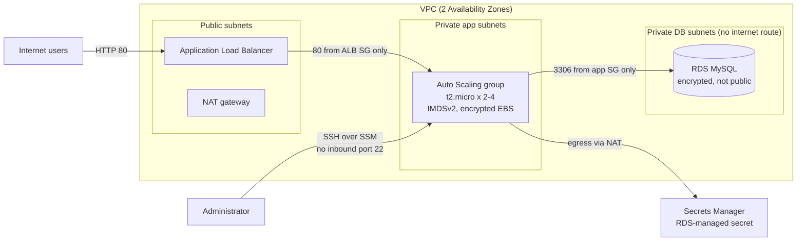

# AWS 3-Tier Web App: Terraform Build with Continuous Compliance Evidence

Re-architecture of a PHP + MySQL web application from a single public EC2 host into a
highly available, private, three-tier design on AWS, built entirely with Terraform and
assessed against FedRAMP 20x Key Security Indicators (KSIs) and NIST 800-53 controls.

> Built as a solo capstone for a cloud security course (AWS Academy Cloud Architecting
> scenario). The lab instructions, application code, and dataset belong to AWS and are
> **not** included in this repository.

## Status

| Phase | Scope | Status |
|---|---|---|
| 1 | Terraform build: ALB, Auto Scaling group, RDS MySQL, Secrets Manager, data import | Done |
| 1b | Cost control: one `stack_enabled` switch removes the NAT gateway, ALB, ASG and RDS when idle | Done |
| 2 | Least-privilege egress per tier, default security groups locked down | Done |
| 2b | Drift detection against manual console changes | Planned |
| 3 | Evidence collection with [paramify-fetchers](https://github.com/paramify/paramify-fetchers) and regex validators. KSI-CNA-RNT works from two sources; 3-day schedule and Paramify upload are next | In progress |
| 4 | Shift-left IaC scanning (Checkov) as a pre-deploy gate | Planned |

## Architecture



**Traffic is chained by security group reference, not CIDR:** internet to ALB, ALB to
app tier, app tier to database. The database subnets have no route to the internet.

## Requirements traceability

| Requirement | Implementation | KSI / Control |
|---|---|---|
| Secure hosting of the MySQL database | RDS in private DB subnets, `publicly_accessible = false`, storage encrypted | KSI-SVC, SC-28 |
| Secure access to the database | DB security group allows 3306 only from the app security group; credentials in Secrets Manager | KSI-CNA, AC-3, IA-5 |
| Anonymous access for web users | Internet-facing ALB on port 80 | Scope assumption |
| Web servers in private subnets with admin access | ASG in private subnets; admin access via SSH tunneled through SSM Session Manager | KSI-CNA, AC-17 |
| High availability through a load balancer | ALB across two AZs with health checks | KSI-CNA, CP-10 |
| Automatic scaling with a launch template | Launch template + ASG (min 2, max 4) with CPU target tracking at 50% | KSI-CNA, SC-5 |

## Key design decisions

- **Brownfield adoption instead of rebuild.** The environment came with pre-provisioned
  security groups. They are brought under Terraform with `import {}` blocks and
  `lifecycle { prevent_destroy = true }`, keeping their IDs and existing tags, so
  Terraform owns their rules and drift detection covers them. Pre-provisioned network
  resources (VPC, subnets, DB subnet group, IAM instance profile) are referenced with
  `data` sources and never managed.
- **No database password in code or state.** `manage_master_user_password = true` lets
  RDS create and rotate the secret in Secrets Manager. The password never appears in
  Terraform files or `terraform.tfstate`.
- **Hardened launch template.** Reuses the source template's AMI and bootstrap through a
  data source (so no third-party content is copied), then adds IMDSv2 enforcement
  (`http_tokens = "required"`), an encrypted gp3 root volume, and consistent tagging.
- **SSH without open ports.** Administrators use real SSH tunneled through SSM Session
  Manager (`AWS-StartSSHSession`). No security group allows inbound port 22, there is
  no bastion host, and every session is authenticated by IAM and recorded by SSM.
- **Credential-safe data import.** The SQL dump was loaded from an app instance through
  an SSM session, reading credentials from Secrets Manager at runtime, passing the
  password through `MYSQL_PWD` instead of the command line, and deleting the dump after.

- **Cost switch.** The lab has a fixed budget, so every billable resource sits behind
  `count = var.stack_enabled ? 1 : 0`. The lab's NAT gateway was imported so it can be
  switched off too. `scripts/stack.sh down` leaves only free resources (security groups,
  launch template) and costs nothing while idle.

## Security assessment findings

Findings from reviewing the starting environment, the provided application, and the lab
configuration. Items marked *accepted* are out of scope for this build by design; items marked
*remediated* were fixed in Phase 2 and verified by the validators below.

| # | Finding | Control | Severity | Recommendation |
|---|---|---|---|---|
| 1 | Application writes the database password to the web server error log in plaintext on every request | IA-5, AU-9 | High | Remove the logging call; RDS-managed rotation limits exposure as a compensating control |
| 2 | Web server role has `ReadOnlyAccess` to the whole account plus write access to every secret | AC-6 | High | Scoped policy: `GetSecretValue` on one secret ARN, `rds:DescribeDBInstances`, SSM core |
| 3 | No CloudTrail trail, VPC Flow Logs, or AWS Config recorder | AU-2, AU-12, CA-7 | High | Organization trail, flow logs to S3, Config conformance pack |
| 4 | HTTP only, no TLS on the load balancer | SC-8 | High (*accepted* per scope) | ACM certificate, HTTPS listener, HTTP-to-HTTPS redirect |
| 5 | Application selects the first secret and first RDS instance in the account | CM-6 | Medium | Pass the secret ARN and endpoint explicitly (environment or SSM parameter) |
| 6 | MySQL server package installed on every web server | CM-7 | Medium | Install the client only, or bake a minimal AMI |
| 7 | Code downloaded at boot without integrity checks; unpinned package updates | SI-7, CM-2 | Medium | Golden AMI via EC2 Image Builder, or hash-verified artifacts from a private bucket |
| 8 | Unrestricted egress on all tiers, including the database | SC-7 | Medium, *remediated* | Phase 2: ALB sends only port 80 to the app subnets; app sends only 443 out and 3306 to the DB subnets; DB has no egress |
| 9 | Single NAT gateway in one AZ; single-AZ database | CP-10 | Medium | One NAT per AZ (or VPC endpoints); Multi-AZ RDS |
| 10 | Port 443 allowed on ALB and app security groups with no HTTPS listener | CM-7 | Low | Remove until TLS is implemented |
| 11 | Default VPC present with auto-assigned public IPs; default security groups allowed traffic | CM-7 | Low, partly *remediated* | Default security groups in both VPCs adopted into Terraform with every rule removed (CIS AWS 5.4). Deleting the unused default VPC is still recommended |

## Continuous evidence: KSI-CNA-RNT (Restricting Network Traffic)

One claim, proven from two independent sources:

| Fetcher | Source | Proves |
|---|---|---|
| `aws_security_group_traffic_restriction` | EC2 `DescribeSecurityGroups` with a read-only identity | What AWS enforces right now |
| `terraform_security_group_traffic_restriction` | This project's Terraform state | What was declared, reviewed and applied |

Both fetchers write the same summary fields, so one set of regex validators (evaluated
with the same ECMAScript engine Paramify uses) checks both evidence sets:

| Validator | Passes when |
|---|---|
| `collection_succeeded` | The fetcher run finished without errors |
| `sg_groups_evaluated` | At least one security group was evaluated, so empty evidence cannot pass |
| `sg_world_ingress_authorized_ports_only` | Nothing is open to 0.0.0.0/0 or ::/0 except ports 80 and 443 |
| `sg_no_world_open_admin_ports` | SSH (22) and RDP (3389) are not open to the internet |
| `sg_no_world_open_database_ports` | No database port is open to the internet |
| `sg_no_unrestricted_egress` | No security group allows all traffic outbound to the internet |

Each validator has passing, failing and renamed-field test cases, which proves it can
actually fail. The Terraform fetcher copies only security group attributes out of state;
a test plants a fake secret in a state fixture and confirms it never reaches the evidence.

**Results from the lab** (collected with the stack switched off, at no cost):

| Run | AWS API | Terraform | `sg_no_unrestricted_egress` |
|---|---|---|---|
| Before Phase 2 | 5 groups, 5 with unrestricted egress | 3 groups, 3 with unrestricted egress | FAIL on both |
| After Phase 2 | 5 groups, none with unrestricted egress | 5 groups, none with unrestricted egress | PASS on both |

The first run showed why two sources matter. AWS reported two default security groups
that existed in no code, so a Terraform-only audit would have missed them. Adopting them
closed the gap, and both sources now report the same five groups.

Evidence files contain account and resource IDs, so they are kept out of this repository.

## Lab constraints and full-access recommendations

The lab account could not create IAM roles and limited services to what the scenario
required. With full access, the recommended production design adds:

- **Identity:** IAM Identity Center with MFA for console access; per-workload least-privilege roles
- **Governance:** AWS Organizations with service control policies; Control Tower landing zone
- **Detection:** Security Hub (NIST 800-53 standard), GuardDuty, CloudTrail with metric alarms
- **Network:** WAF on the ALB, VPC endpoints for SSM and Secrets Manager, NAT per AZ
- **Data:** customer-managed KMS keys, Multi-AZ RDS, deletion protection, automated backups retained 7+ days
- **Delivery:** remote Terraform state in encrypted S3 with locking; CI/CD-gated `terraform apply`

## Repository layout

```
.
├── README.md
├── .gitignore                      # state, tfvars, lab material, local evidence
├── scripts/
│   └── stack.sh                    # up | down | status: cost switch wrapper
└── terraform/
    ├── .terraform.lock.hcl         # pinned AWS provider version
    ├── versions.tf                 # Terraform/provider versions, default tags
    ├── variables.tf                # inputs (network names, sizing, cost switch)
    ├── data.tf                     # lookups: VPCs, subnets, route table, source launch template
    ├── network.tf                  # adopted NAT gateway, EIP and app route (switchable)
    ├── security_groups.tf          # imported ALB/app/DB SGs with least-privilege egress
    ├── default_security_groups.tf  # default SGs in both VPCs, all rules removed
    ├── database.tf                 # RDS MySQL with RDS-managed secret
    ├── load_balancer.tf            # ALB, target group, HTTP listener
    ├── compute.tf                  # hardened launch template, ASG, CPU scaling policy
    ├── moves.tf                    # state moves from adding the cost switch
    ├── outputs.tf                  # app URL, DB endpoint, secret ARN, ASG name
    └── lab.auto.tfvars.example     # template; copy to lab.auto.tfvars (gitignored)
```

## Deploy

**Prerequisites:** Terraform 1.6+, AWS CLI v2, Session Manager plugin, an AWS profile
with credentials for the target account.

```bash
cp terraform/lab.auto.tfvars.example terraform/lab.auto.tfvars   # fill in your IDs
export AWS_PROFILE=<profile>
cd terraform
terraform init
terraform plan -out=plan.tfplan     # review: nothing should be replaced or destroyed
terraform apply plan.tfplan
terraform output app_url
```

**Turn billable resources off and on** (the lab budget is fixed, so nothing runs while idle):

```bash
export AWS_PROFILE=<profile>
scripts/stack.sh down     # removes NAT gateway, ALB, ASG and RDS; security groups and launch template stay
scripts/stack.sh status   # confirm nothing billable is running
scripts/stack.sh up       # recreates everything in about 10 minutes; RDS comes back empty, so re-import the data
```

## Repository hygiene

- Never committed: Terraform state, `*.auto.tfvars`, account IDs, credentials, lab materials
- Every commit scanned with [gitleaks](https://github.com/gitleaks/gitleaks) before push
- Infrastructure uses default tags (`Project`, `Environment`, `ManagedBy`) for traceability

## Roadmap

- **Phase 2b:** remove the unused 443 rules, then demonstrate drift detection
  (`terraform plan -detailed-exitcode`) against a manual console change
- **Phase 3:** collector instance running paramify-fetchers on a 3-day schedule
  (systemd timer), uploading JSON evidence to Paramify where regex validators map
  results to KSIs
- **Phase 4:** Checkov scan of this Terraform as a pre-deploy gate, with its results
  uploaded as evidence alongside the runtime checks
